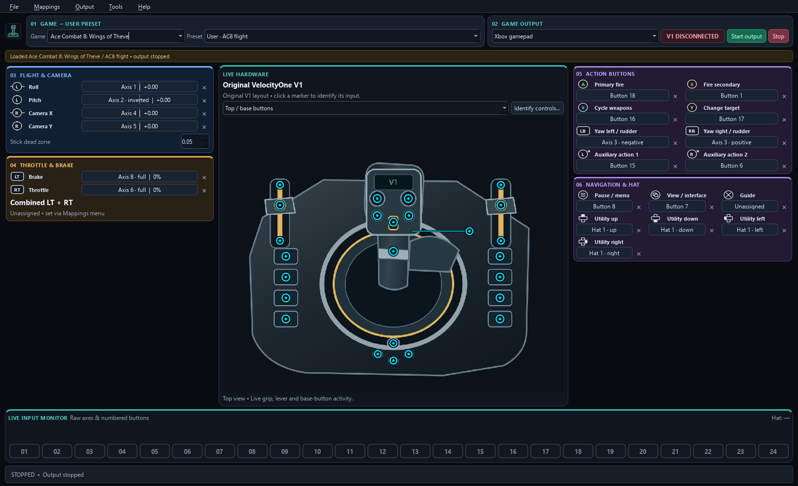

# VelocityOne Flightstick Mapper V1

**An independent Windows mapper for the original Turtle Beach VelocityOne Flightstick V1.** Map physical controls to a virtual Xbox gamepad or keyboard/mouse, see live inputs, and save setups by game. No x360ce or ViGEm.

[Download preview v0.1.0](https://github.com/mnwinter/VelocityOne_FlightStick_Mapper_V1/releases/tag/v0.1.0) · [Setup](#quick-start) · [Report a bug](https://github.com/mnwinter/VelocityOne_FlightStick_Mapper_V1/issues/new/choose) · [Project site](https://mnwinter.github.io/VelocityOne_FlightStick_Mapper_V1/)



## What it does

- Live V1 schematic with clickable controls, stick/twist motion, sliders, detents and button activity.
- Xbox control symbols with **editable game-action names**. Axis bars show proportional output; buttons show held state.
- Game → user preset selection, 32 editable starter layouts across 16 flight/space titles, and preserved calibration.
- Macros with ordered steps, simultaneous outputs, hold durations, delays, repeat count, while-held and toggle modes.
- Separate keyboard/mouse output. Driver setup and dependency notices are included; no Python installation is needed for release binaries.
- Black interface, native dark Windows title bar, and compact menu-based tools.

**Preview status:** not a universal compatibility guarantee. The owner has reported Ace Combat 8 working; that is not independent game certification. Other starters are proposed layouts and require verification in the game. Original V1 only; V2/Flightdeck/HOTAS models are not claimed compatible.

## Requirements

Windows 11 x64, the original V1 in **PC mode**, and the [official Microsoft Visual C++ x64 runtime](https://learn.microsoft.com/cpp/windows/latest-supported-vc-redist) if not already installed. Microsoft runtime DLLs are not redistributed in this package. For virtual Xbox output, install the bundled signed **USBIP** driver once and restart Windows if its installer requests it. Driver installation needs administrator approval; the mapper normally does not.

The download includes Python, Qt/PySide6, pygame/SDL, VIIPER and the USBIP installer. It still depends on Windows/runtime prerequisites. The mapper executable itself is **unsigned**, so Windows may flag an unfamiliar publisher; verify the release checksum and source. Do not bypass a security warning you do not understand.

## Quick start

1. Download `VelocityOneMapper-v0.1.0-Windows-x64.exe`, or extract the portable ZIP and keep its whole folder together. Portable libraries remain replaceable.
2. Connect the original stick in PC mode. Close other controller mappers to avoid duplicate input.
3. Open **Tools → Driver setup / dependencies** for first-time virtual-controller setup.
4. Select **Game**, then a starter or saved **Preset**. The app loads without autosaving over presets.
5. Click a binding box to learn/edit its physical input. Edit the action name beside the Xbox symbol. **File → Save preset (Ctrl+S)** saves your setup.
6. Select **Xbox gamepad → Start output**. Confirm the virtual controller in **Tools → Windows controller test**, then verify each game binding.

Stop output before editing or leaving the app. **Ctrl+Alt+F12** is the emergency stop while the UI loop is responsive. Closing with unsaved changes offers Save/Discard/Cancel. Disconnect/stalled input stops output; reconnecting does not automatically restart it.

## Menus and controls

- **File:** Save, New, Rename, Import, profile folder, Exit.
- **Mappings:** keyboard/mouse bindings, graphic-input identities, macros and combined LT+RT button.
- **Output:** live mapped output preview, Start, Stop.
- **Tools:** identify/calibrate controls, Windows controller test, driver/dependency setup.
- **Help:** game setup and suggested binding guide.

For Ace Combat 8, owner-confirmed action names are **B: Fire secondary**, **X: Cycle weapons**, **Y: Change target**; **LB/RB** are rudder/yaw and **RX/RY** are look. Starters route negative/positive twist to LB/RB. Those are digital buttons, so they engage after the mapped threshold, not proportional rudder axes. Learn physical button numbers for your preferences.

For wheel up/down pulses, set the stick OLED's **Trim Wheel → Response → Digital Buttons**, then Learn each direction. The wheel-press dot represents Button 15; separate rotation overlay markers are not implemented. Do not infer up/down from the press marker.

## Profiles, macros and troubleshooting

Release builds store user data in `%LOCALAPPDATA%\VelocityOneMapper`. Source runs use their source directory unless `--data-dir PATH` is supplied. No personal profiles or logs are shipped. Back up this folder before experimenting with versions.

Macros live in each user preset. One step may hold several key/mouse/gamepad outputs together; empty steps create pauses. Windows scheduling is not real-time. Keyboard/mouse output goes to the focused app and may be rejected by elevated games or anti-cheat systems. This app does not modify game files, hide the physical stick or configure Steam.

If the game stops responding, confirm **Start output** is active and that the virtual controller exists in Windows. Some games discover controllers only at launch. For 50%/reversed throttle, verify full-range mapping and inversion. VIIPER uses two private loopback ports per mapper instance; logs are under the user data `logs` directory. No recurring task, telemetry or autostart is installed by the mapper.

See [known limitations and verification](docs/verification.md) and [dependency sources/replacement](docs/dependency-sources.md).

## Build from source

```powershell
py -3.12 -m venv .venv
.\.venv\Scripts\python.exe -m pip install -r requirements.txt
.\scripts\fetch-dependencies.ps1
.\build.ps1 -Python .\.venv\Scripts\python.exe -Kind onefile
.\build.ps1 -Python .\.venv\Scripts\python.exe -Kind portable
```

The fetch script pins hashes and checks Authenticode signatures; it never installs or runs downloads. Build inputs include backend corresponding source. Tests run before packaging. `--data-dir PATH --render preview.png` renders offscreen using isolated data. Building original art additionally uses QtSvg: `python scripts/generate_v1_art.py`.

## License and independence

**GPL-3.0-only** for the mapper and its original artwork; see [LICENSE](LICENSE). Dependencies retain their licenses. [Notices and source links](THIRD_PARTY.md) are provided with the builds. Manufacturer photographs are excluded from every public asset and binary. The illustrations show the original V1 control layout; they are not manufacturer photographs or factory calibration.

Turtle Beach, VelocityOne and Xbox identify relevant hardware/interfaces and remain their owners' trademarks. This project is not endorsed by or affiliated with those manufacturers.

## Help it improve

Test a starter and report your game, control scheme, firmware and what Windows sees. Share the release link with other original-V1 owners. Please describe reproducible behavior; redact personal information before uploading profiles or logs.

